# Zentra Licensing — Diagrams

Companion visuals to [LICENSING_PROMPTS.md](LICENSING_PROMPTS.md) and the plan file at `~/.claude/plans/how-does-the-licensing-synchronous-blum.md`.

All diagrams use Mermaid — render in GitHub, VS Code (with Mermaid extension), Obsidian, or any Mermaid live viewer.

---

## 1. System overview — three subsystems

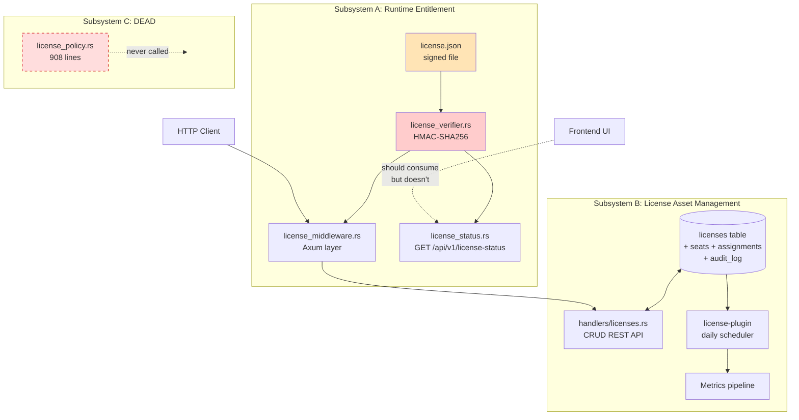

🔴 red box = security-critical (HMAC scheme).
🟡 dashed-red box = dead code.
Dotted line = intended but not implemented integration.

---

## 2. Request flow — what happens on every HTTP request today

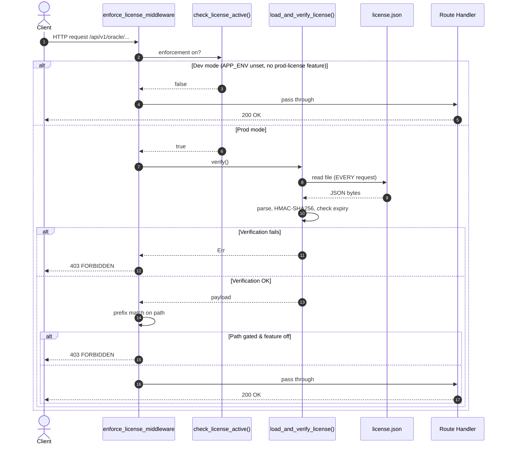

**Pain point highlighted:** step 8 — disk read + parse + MAC on every request, no caching.

---

## 3. License file data model (Subsystem A)

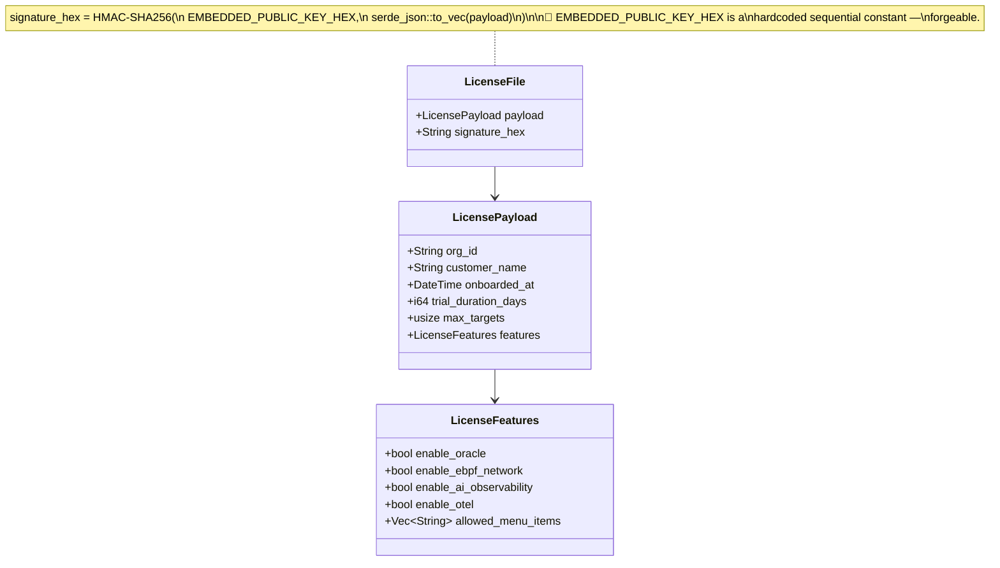

---

## 4. Subsystem B data model — License asset management

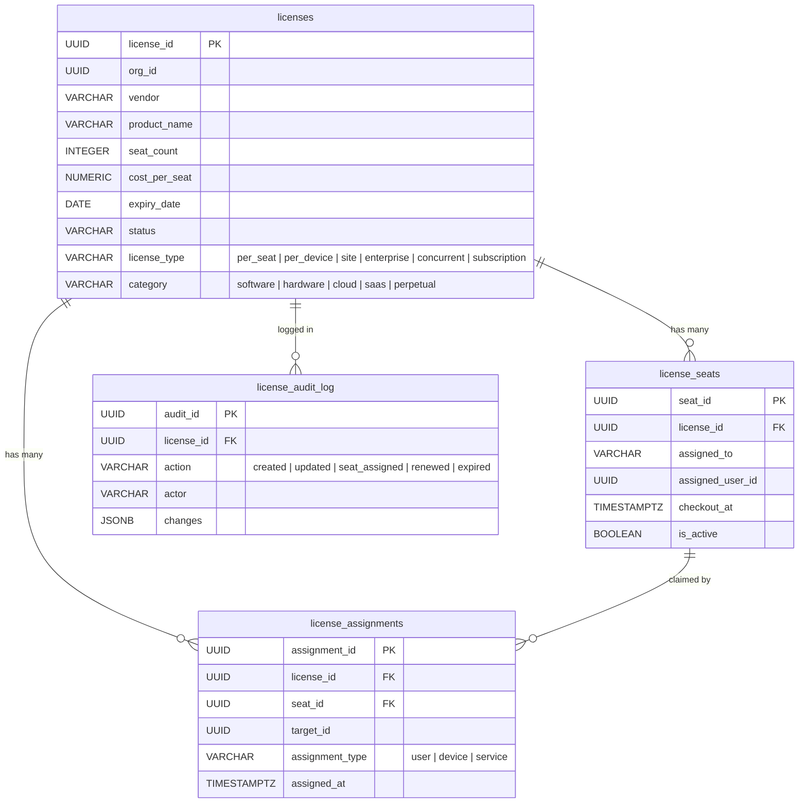

---

## 5. Subsystem B — daily compliance scheduler

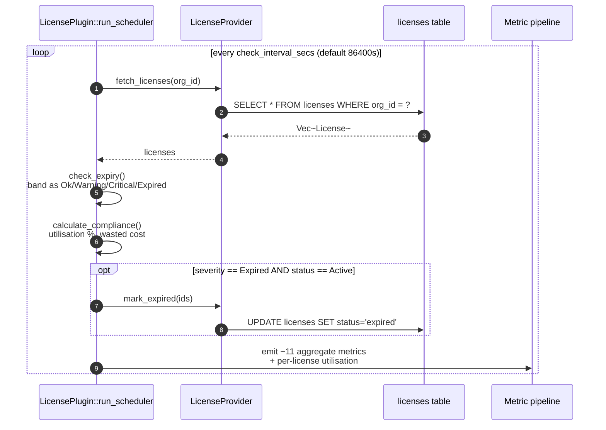

---

## 6. Call graph — what calls what (today)

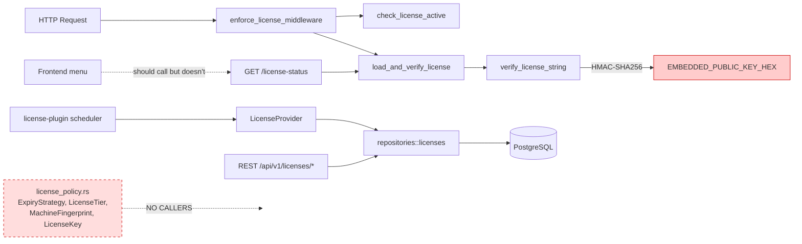

---

## 7. Current vs. target architecture (after rollout)

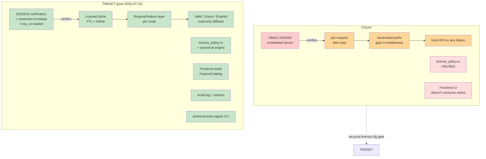

---

## 8. cfg-gating model (after T01)

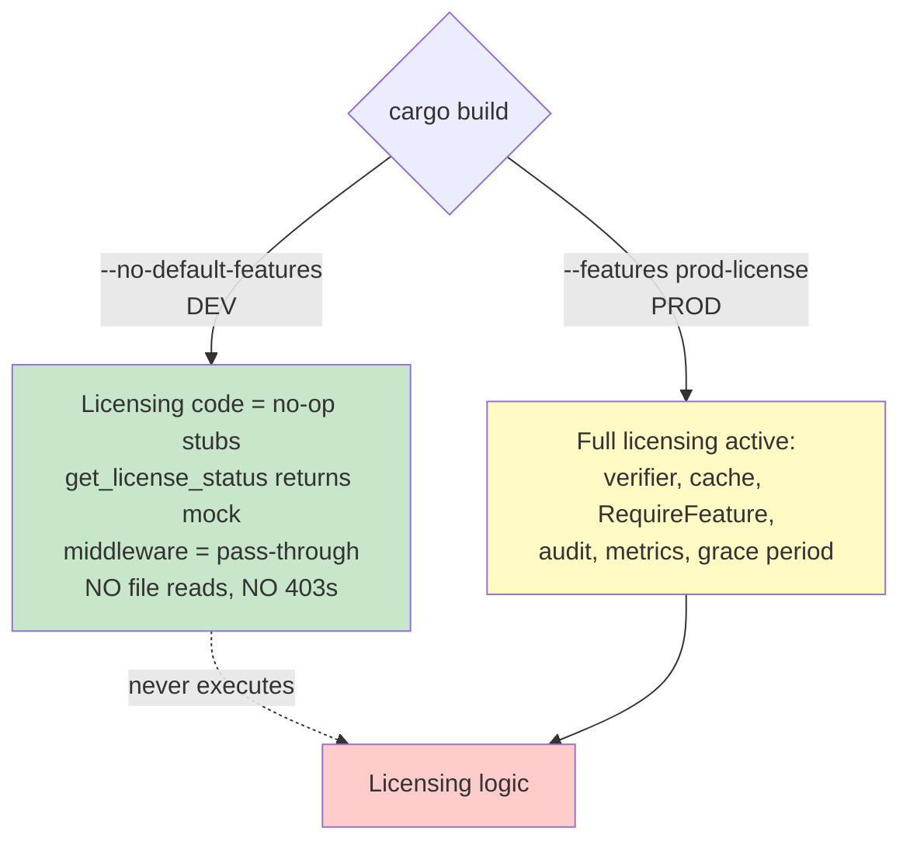

The cargo feature is the **only** switch. No env var, no runtime config — it's compile-time, non-bypassable.

---

## 9. Future request flow (after T13 cache + T14 RequireFeature + T15 grace)

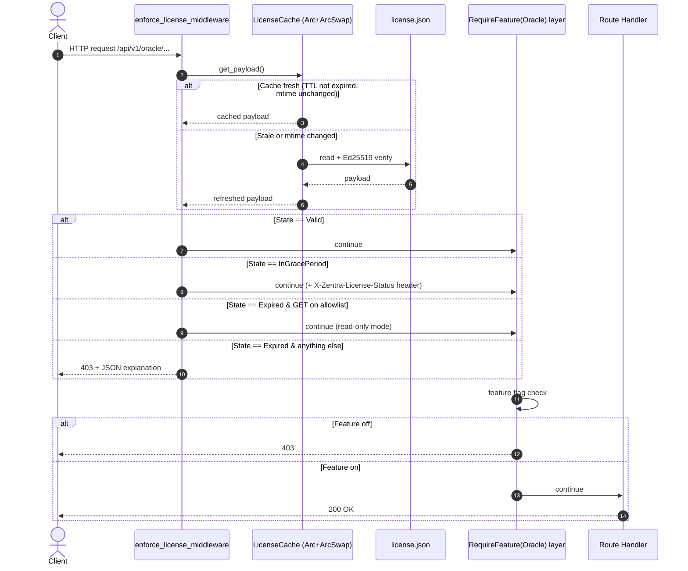

---

## 10. Rollout timeline (Gantt)

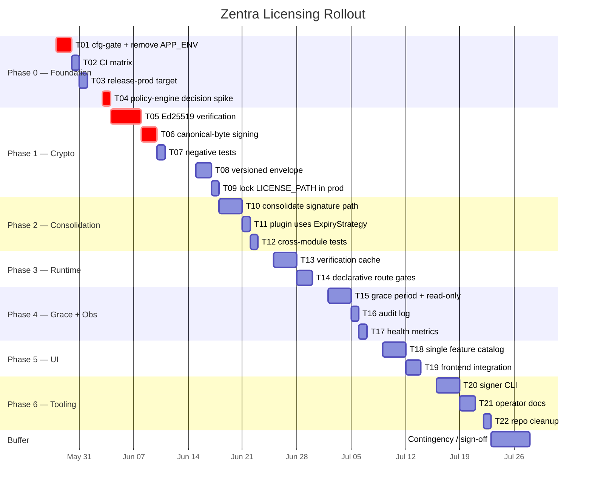

---

## 11. Task dependency graph

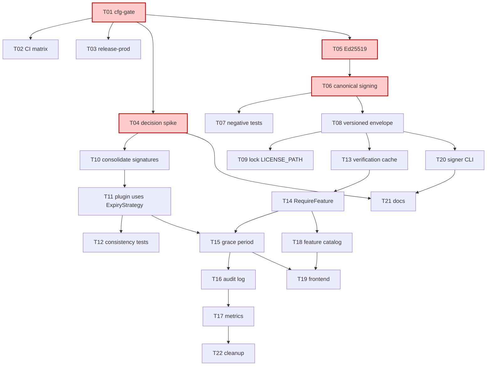

🔴 red nodes = critical path. T01 unblocks everything; T04 unblocks consolidation; T05+T06 are the security-critical core.

---

## 12. License state machine (after T15 grace period)

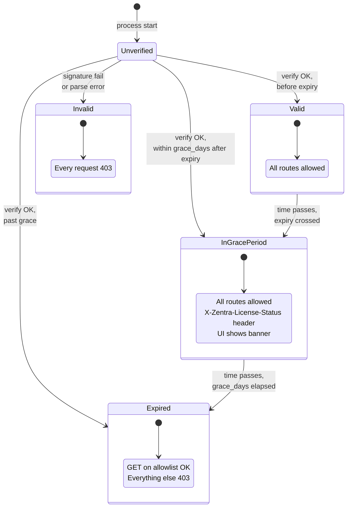

---

## How to use these diagrams

- **Onboarding a new engineer** → start with diagram 1 (overview), then 2 (request flow), then 6 (call graph).
- **Security review** → diagrams 2, 3, 9 highlight the verification path and where Ed25519 + canonical bytes drop in.
- **Sprint planning** → diagrams 10 (timeline) and 11 (dependencies) drive the schedule.
- **Product / sales conversations** → diagram 12 (state machine) and 7 (current-vs-target) are the most accessible.
